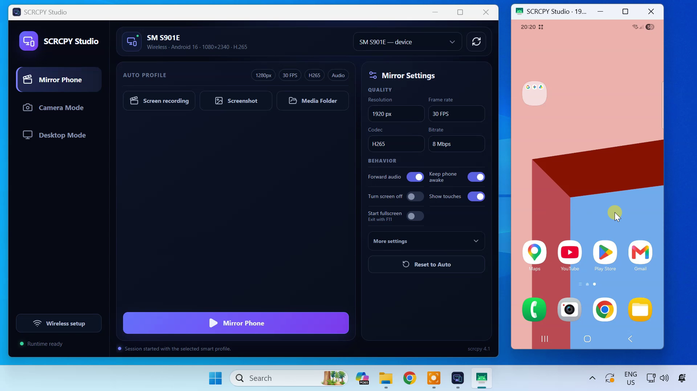
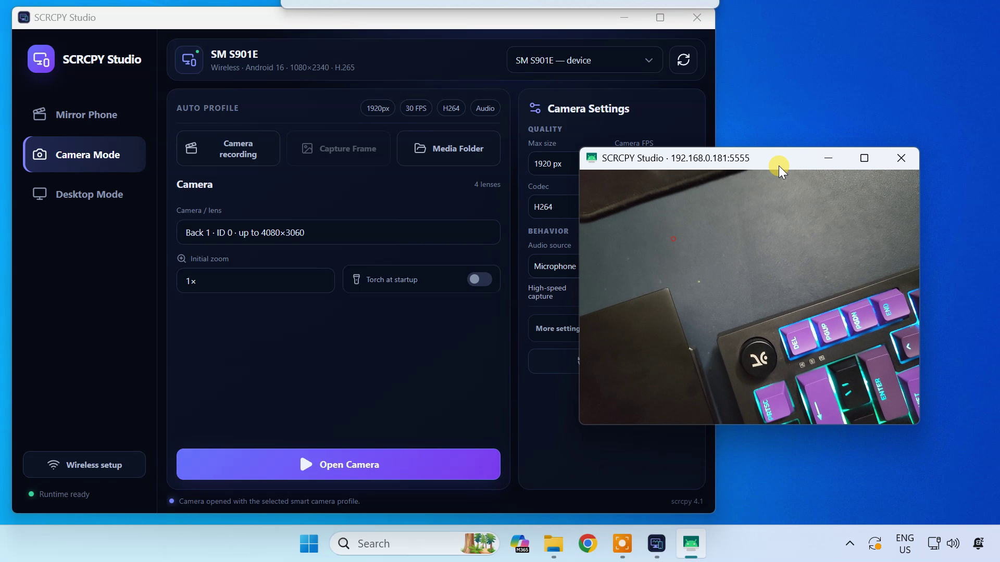
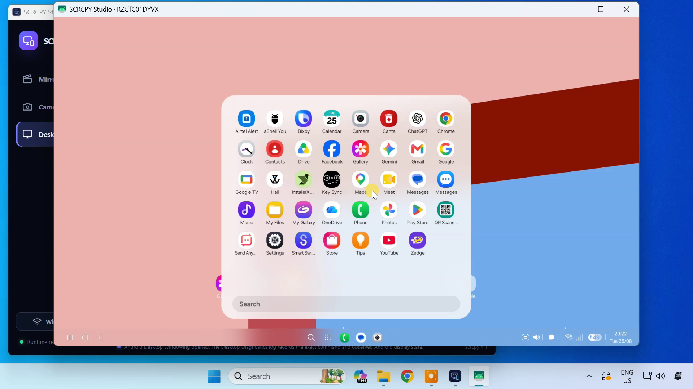

# SCRCPY Studio

**A clean desktop interface for scrcpy, with a native-feeling macOS build.**

SCRCPY Studio is an independent Tauri + React desktop frontend for the official [Genymobile scrcpy](https://github.com/Genymobile/scrcpy) project. It turns common scrcpy workflows into compact, mode-specific controls while retaining automatic compatibility fallbacks and detailed logs when something fails. The app builds for macOS as well as Windows; the macOS build uses the system's Homebrew-installed scrcpy and Android Platform Tools.

## Screenshots

### Mirror Phone



### Camera Mode



### Desktop Mode



## Download

Download the latest published release from [GitHub Releases](https://github.com/techydruid/SCRCPY-Studio/releases/latest). Published installers currently target Windows; build the macOS app locally using the development steps below.

- **Setup EXE** — recommended for most users; installs for the current Windows user.
- **Portable EXE** — runs without installation.

The binaries are currently unsigned, so Microsoft Defender SmartScreen may show an unknown-publisher warning. The release includes `SHA256SUMS-Windows-x64.txt` for download verification.

## Requirements

- Windows 10 or 11, 64-bit, or macOS
- An Android device with Developer options and USB debugging enabled
- Android 5.0 or newer for screen mirroring
- Android 12 or newer for Camera Mode

On macOS, install the dependencies with Homebrew: `brew install scrcpy` or install ADB separately with `brew install android-platform-tools`. On Windows, SCRCPY Studio can download the latest official scrcpy package and verify its published SHA-256 checksum before installing it to the app's local runtime directory. On macOS, it discovers Homebrew tools in standard Apple Silicon and Intel Homebrew locations and does not modify the Homebrew installation automatically.

## Modes

### Mirror Phone

Everyday phone mirroring and control with resolution, frame rate, codec, bitrate, audio, orientation, crop, screen-off, awake, fullscreen, recording, screenshot, and media-folder controls. If an aggressive profile exits immediately, SCRCPY Studio retries safer codec, size, and frame-rate combinations.

### Camera Mode

Streams a supported phone camera directly through scrcpy. Camera/lens selection, zoom, torch, camera FPS, audio source, aspect ratio, recording, and high-speed capture are presented only where they apply.

### Desktop Mode

Creates or captures a secondary Android display without claiming that every virtual display is a desktop environment:

- **Virtual Display** is a generic secondary display created by scrcpy `--new-display`.
- **Android Desktop Windowing** is used only when Android exposes the required freeform/windowing behavior.
- **Samsung DeX** is not started by a scrcpy-created display. It is usable only when Samsung firmware already exposes an active DeX display that scrcpy can capture.

Desktop Mode can enable the supported Android freeform/resizable settings in one user-confirmed action, restart the phone, reconnect automatically, and later restore the settings it backed up. Exact commands, results, display details, activities, windowing state, and relevant Android settings are written to Desktop logs instead of cluttering the normal interface.

## Wireless setup

Connect a USB-authorized phone to switch it to wireless ADB automatically. Successful connections are remembered for quick reconnects. A collapsed **Manual setup** section exposes `adb pair` and `adb connect` for new Android 11+ phones or connection recovery.

User-supplied addresses and pairing codes are passed directly as process arguments; they are not interpolated into a shell command.

## Safety and privacy

SCRCPY Studio does not root the phone or install a persistent Android app. Android desktop settings are changed only after the user clicks the enable/restore action. Before changing them, the app saves the current values so they can be restored.

The app runs ADB and scrcpy locally. It accesses the internet only when installing the official scrcpy runtime on Windows or when the user connects wirelessly using Android's ADB pairing flow.

## Development

Requirements:

- Node.js 22+
- Rust stable
- Tauri v2 platform prerequisites

```bash
npm install
npm run check
npm run build
cargo test --manifest-path src-tauri/Cargo.toml
npm run tauri build
```

See [macOS port and build notes](docs/macos-build.md) for Homebrew behavior, the tested environment, validation results, and a file-by-file change summary.

CI runs frontend checks, Rust tests, Windows GUI-subsystem validation, and production Windows installer builds. On macOS, `npm run tauri build` creates the app bundle and DMG.

## Third-party software

SCRCPY Studio is not affiliated with Genymobile or the scrcpy authors. scrcpy is a separate project licensed under the Apache License 2.0. SCRCPY Studio downloads scrcpy only from Genymobile's official GitHub release and verifies the release checksum.

## License

SCRCPY Studio is released under the MIT License. See [LICENSE](LICENSE).
